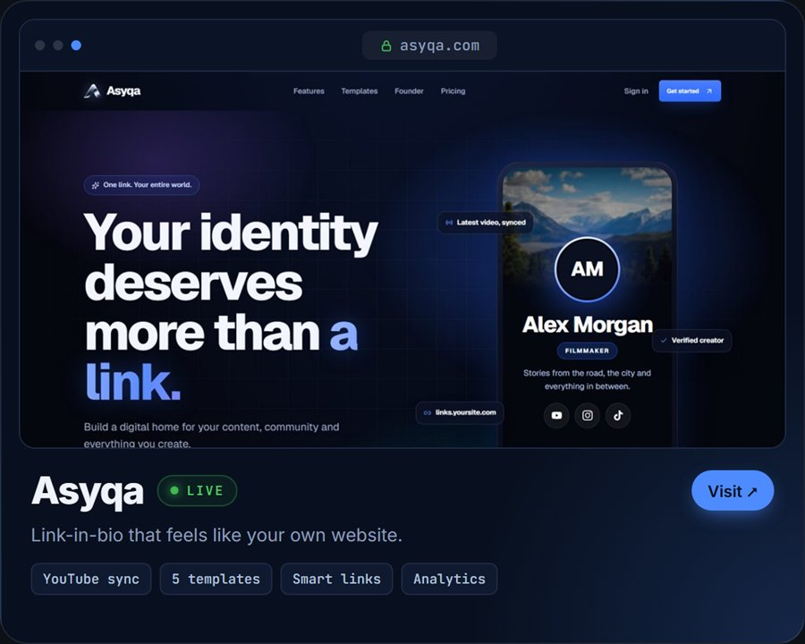
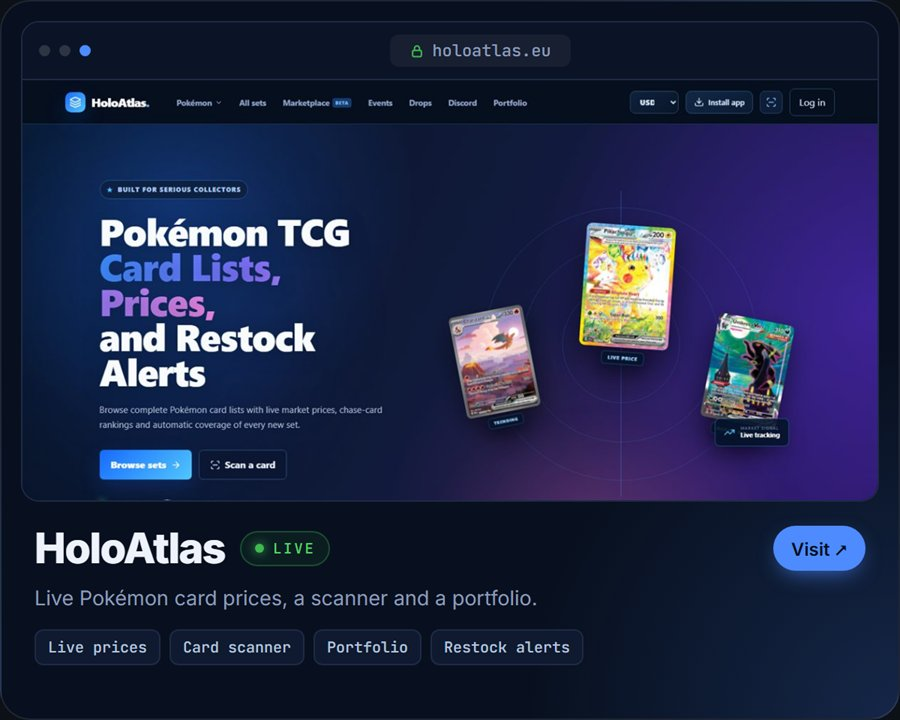

  
  &nbsp;
  

  Hey, I'm Rowan. Developer from the Netherlands. 
  I build web apps, SaaS, FiveM scripts, Discord bots and whatever else I need.

 

 
 

  
  

 
 

 
 

 
 

  

Got an idea? Send me a message. Made in NL, probably at 2am.

