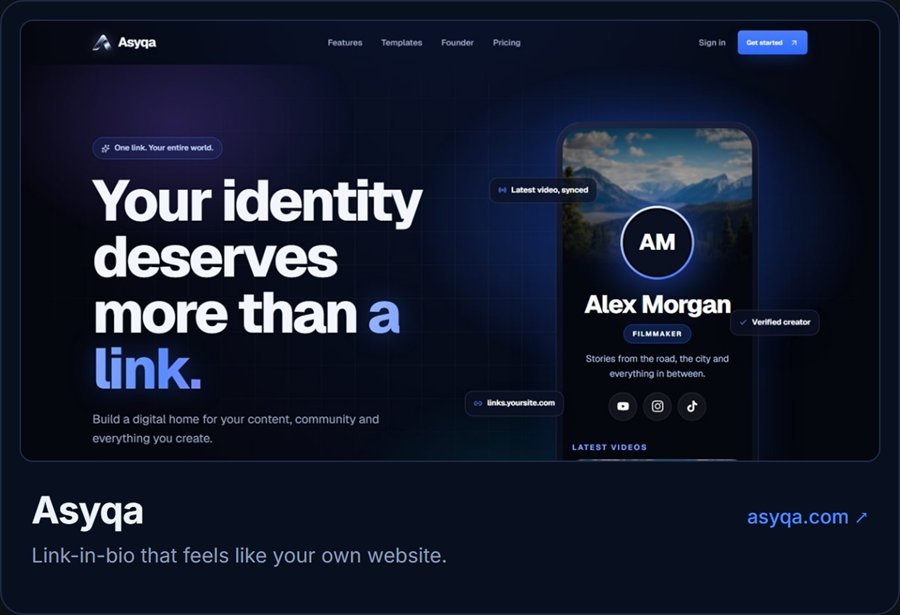
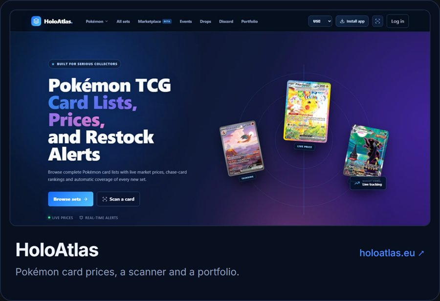

Hey, I'm Rowan. I build web apps, SaaS, FiveM scripts, Discord bots and whatever else I need. Right now most of my time goes into [Asyqa](https://asyqa.com/) and [HoloAtlas](https://holoatlas.eu/).

[Discord](https://discord.com/users/1364998854537384077) &nbsp;·&nbsp; [asyqa.com](https://asyqa.com/) &nbsp;·&nbsp; [holoatlas.eu](https://holoatlas.eu/)

 

### How I got here

 

### What I'm building

 

### What I've built

 

### What I build with

 

Got an idea or a question? Send me a message on [Discord](https://discord.com/users/1364998854537384077).
