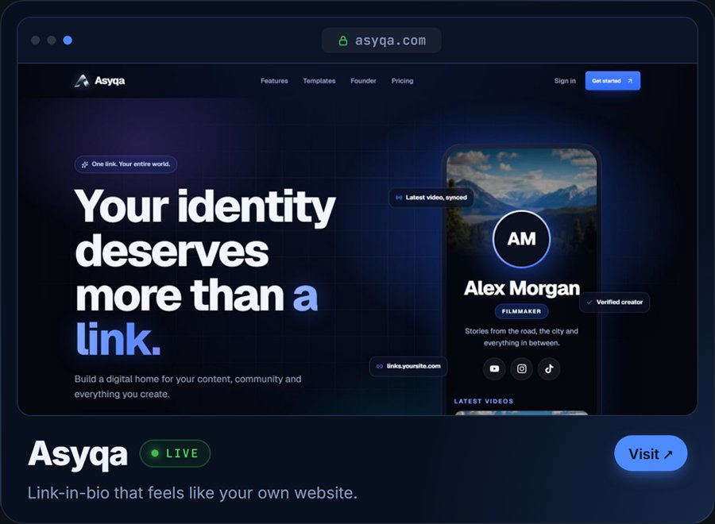
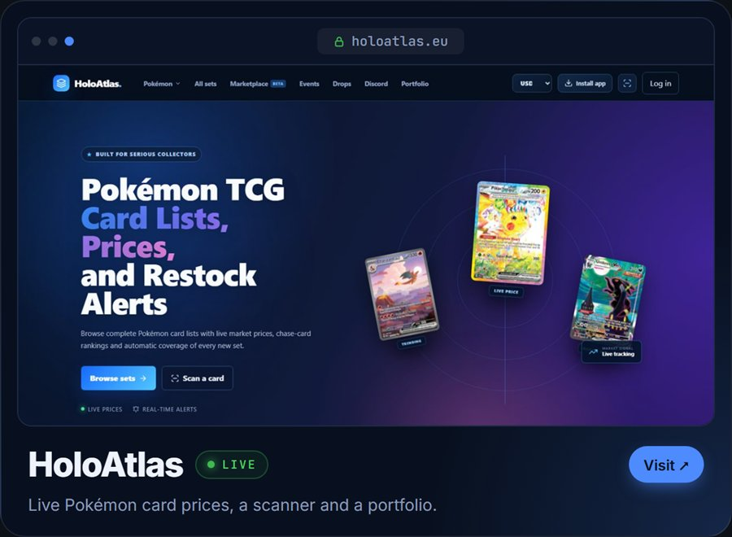

  
  &nbsp;
  

  Hey, I'm Rowan. Developer from the Netherlands. 
  I build web apps, SaaS, FiveM frameworks, Discord bots and whatever else I need. 
  Right now: <a href="https://asyqa.com/">Asyqa</a> and <a href="https://holoatlas.eu/">HoloAtlas</a> are live, and the Asyqa CRM is next.

 

  
  

**[Asyqa](https://asyqa.com/)** is link-in-bio, but it feels like your own website. Connect YouTube once and your newest upload shows up by itself, pick one of five templates, and get analytics without fake numbers.

**[HoloAtlas](https://holoatlas.eu/)** is for Pokémon card collectors: every set and every card with live market prices, a card scanner, restock alerts and a portfolio for your collection.

 

Next up is the **Asyqa CRM**: a multi-tenant CRM that works for 18 different industries, from car dealers to schools, without being 18 different apps. Every account gets a customer portal with contacts, calendar, tickets, invoices and team chat. 2FA is required for everyone, passkeys are supported. Still private while I build it out.

 

 

 
 

Got a question or an idea? Find me on <a href="https://discord.com/users/1364998854537384077">Discord</a>.

